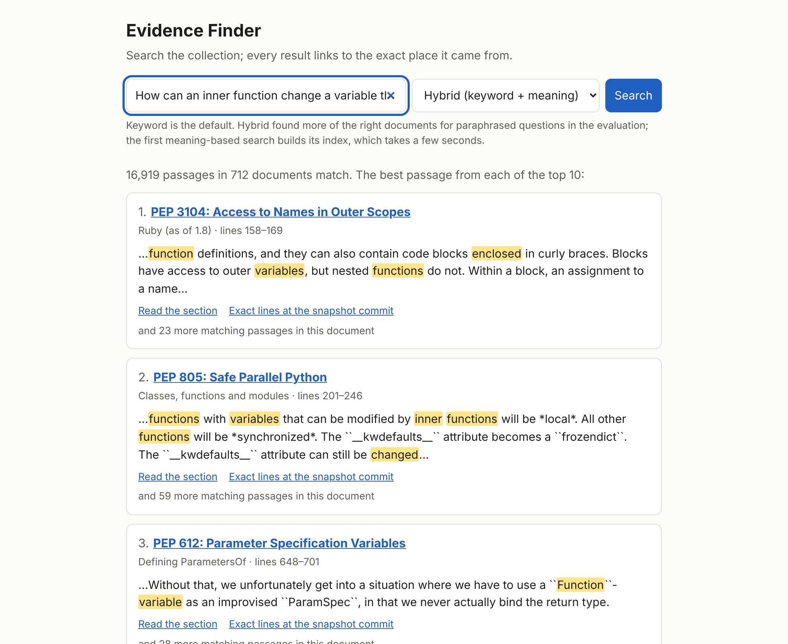
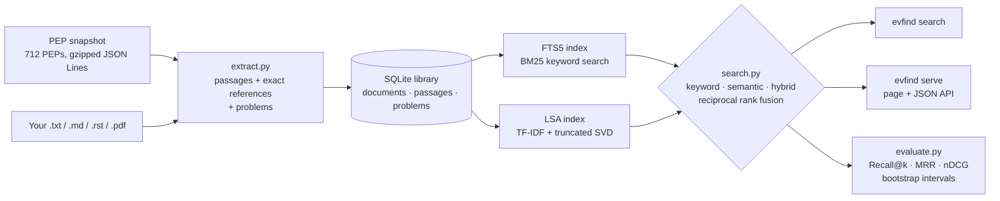

# Evidence Finder

[](https://github.com/SohamMessi10/evidence-finder/actions/workflows/tests.yml)

Search a document collection and get back ranked **passages**, each with an exact reference to
its source: the document, section or page, line numbers, and links. Every result can be checked.
Search quality is measured on held-out questions with confidence intervals, so each claim that
one method beats another comes with numbers, including the claims that didn't hold up.



## The problem

"Chat with your documents" demos show an answer but rarely where it came from, and almost never
measure whether retrieval found the right material. Evidence Finder does the retrieval half
properly:
- **Results are passages, not whole documents**, each with its section and line range, and a
  link to the exact lines in the source at a fixed commit.
- **Failures are reported, not hidden:** scanned PDFs, password-protected files, unreadable
  pages.
- **Retrieval quality is measured:** keyword, semantic and hybrid search are compared on the
  same held-out questions.

The demo collection is the 712 freely licensed **Python Enhancement Proposals** (PEPs), the
design documents behind Python's features. Your own `.txt`, `.md`, `.rst` and `.pdf` files work
too.

## How good is it?

Measured once on 96 test questions about the PEPs, with every setting chosen beforehand on 49
separate tuning questions (95% bootstrap intervals in brackets):

| | Keyword (BM25) | Semantic (LSA) alone | Hybrid (both, fused) |
|---|---|---|---|
| Recall@10 (labelled PEP in the top 10) | 0.852 | 0.885 | **0.915** [0.858, 0.964] |
| MRR (1 = always first) | 0.708 [0.631, 0.782] | 0.675 | 0.734 [0.660, 0.804] |
| Questions with nothing relevant in the top 10 | 13 | | **7** |

- **Keyword search** is excellent when a question uses the PEP's own words (Recall@10 1.000 on
  those 59 questions). It is weak when the question is paraphrased (0.617 on those 37).
- **Hybrid search** recovers part of that gap. Its Recall@10 gain of +0.062 [+0.010, +0.115]
  over keyword search is the one test-set improvement whose interval lies clearly above zero.
- **No clear gain at the very top:** hybrid search doesn't rank the right PEP first more
  reliably. MRR +0.026, with an interval that includes zero.
- **LSA on its own** is no better than keyword search.
- **Tuning keyword search's column weights** looked good on the tuning questions (+0.076 MRR)
  and didn't clearly carry over to the test questions (+0.030 [−0.008, +0.072]).

Keyword search is the default because that was fixed before the test run; making hybrid the
default would need a fresh set of questions to confirm. The questions and labels were written by
Claude, an AI assistant, before any search was run on them, not by independent judges.
[`docs/evaluation.md`](docs/evaluation.md) covers how they were made, what was tuned, every
result and its limits.

## Quick start

Python 3.12, 3.13 or 3.14.

```
python -m pip install -e ".[dev]"
evfind ingest --peps
evfind search assignment expressions
evfind serve
```

`evfind ingest --peps` builds a library (`evfind.db`, about 5 seconds) from the bundled
snapshot: 712 PEPs, 17,165 passages. `evfind serve` opens the search page at
http://127.0.0.1:8765/, on this computer only.

```
1,651 passages in 364 documents match. The best passage from each of the top 2 documents:

  1. PEP 572: Assignment Expressions
     Exceptional cases · lines 149–181
     https://peps.python.org/pep-0572/#exceptional-cases
     source: https://github.com/python/peps/blob/d94bba4a5dff241fd418f30223d3bf05de27a771/peps/pep-0572.rst?plain=1#L149-L181
     There are a few places where **assignment** **expressions** are not allowed, in order to
     avoid ambiguities or user confusion: - Unparenthesized **assignment** **expressions** are
     prohibited at the top level of an **expression** statement…
     and 53 more matching passages in this document

  2. PEP 379: Adding an Assignment Expression
     Abstract · lines 14–18
     ...
```

## Commands

| Command | What it does |
|---|---|
| `evfind ingest --peps` / `evfind ingest FILES...` | Import the PEPs or your own `.txt`, `.md`, `.rst`, `.pdf` files. Unusable files are listed with the reason. |
| `evfind search WORDS... [--method keyword\|semantic\|hybrid] [-n N] [--all-passages]` | Ranked passages with sources. |
| `evfind serve [--port 8765]` | The search page, plus a JSON API at `/api/search?q=…&method=hybrid`. |
| `evfind stats` | What the library holds, and every problem found while importing. |
| `evfind eval [--split test] [--method …] [--compare] [--misses]` | Measure search on the labelled questions. |
| `evfind tune [--method hybrid]` | Try settings on the tuning questions; it refuses test questions. |
| `evfind build-snapshot CHECKOUT -o FILE` | Rebuild the PEP snapshot, byte for byte, from a checkout of github.com/python/peps. |

## How it works



- **Corpus.** The PEP repository has no overall license, so each PEP is included only if its own
  Copyright section puts it in the public domain or under CC0: 712 of 746. Email addresses are
  removed from every header, in place, so line numbers still match the original files.
- **Passages.** Documents are split by section, then grouped into passages of about 180 words
  (never more than 400). Section titles follow reStructuredText's rules, checked against docutils'
  own parser on every PEP. A test checks that every one of the 17,165 passages maps exactly to its
  source lines.
- **Keyword search.** SQLite FTS5 with BM25, Porter stemming and accent folding. Each query word
  is quoted, so nothing typed can be read as query syntax. Documents are ranked by their best
  passage with the title weighted ×8 (tuned). The passage shown is chosen by its section and text
  alone, because FTS5 normalises by the whole row's length and a heavy title weight would
  otherwise always pick a document's shortest passage.
- **Semantic and hybrid search.** LSA (TF-IDF compressed to 100 dimensions by a truncated SVD).
  It's a classical method, used because neural embedding models couldn't be downloaded where this
  was built. Hybrid search fuses the two document rankings with weighted reciprocal rank fusion.
  The index is stored in the library as plain numpy arrays (never pickle) and rebuilt when the
  library changes.

Design details are in [`docs/design.md`](docs/design.md); the measurements are in
[`docs/evaluation.md`](docs/evaluation.md); and the build history, with every bug found, is in
[`PROGRESS.md`](PROGRESS.md).

## Testing

283 tests run on Python 3.12, 3.13 and 3.14, on Linux and macOS:
- **Properties over real data:** every PEP passage maps to its exact source lines, and the
  section-title rule matches docutils' parser on all 712 PEPs.
- **Generated cases (Hypothesis):** no word is lost or reordered when passages are made; any typed
  text gives a valid search query; the search index always matches the passages.
- **Fuzzing:** 300 damaged PDFs per run, plus a one-off run of 40,000, after which extraction
  never crashes.
- **Security:** document text containing `<script>` and `` must come out inert on the
  search page.
- **The published numbers:** a test fails if the code stops producing the evaluation's figures.
- **Mutation testing:** 164 deliberate bugs across the milestones. Each run found gaps in the
  tests, and every survivor has a test now, unless it was shown to change nothing.

## Security and privacy

- `evfind serve` listens on 127.0.0.1 only. The page runs no JavaScript, and a Content Security
  Policy of `default-src 'none'` would stop any script that slipped through. Everything shown is
  HTML-escaped.
- Imported files are read, never executed. File sizes, PDF page counts, query lengths and result
  counts are capped.
- The semantic index is loaded with `allow_pickle=False`, so opening a library can't run code.
- PEP header email addresses are removed. Addresses inside PEP text (mailing lists, examples) are
  kept, so that passages match their source.

## Limitations

- The evaluation's 145 questions were written and labelled by one author (an AI assistant), and
  label only each question's primary answer. Its intervals are wide: differences under about 0.05
  MRR can't be told apart.
- Semantic search is LSA, not a neural model. The remaining misses need knowledge of what a
  construct is for (the `with` statement for "make sure a file gets closed"), which word
  co-occurrence doesn't capture.
- Punctuation and operators can't be searched (`:=` is ignored). Chinese, Japanese and Korean text
  isn't split into words. Scanned PDFs need OCR, which isn't supported.
- The links to exact lines on GitHub use `?plain=1`, which GitHub documents for Markdown files. For
  the PEPs' reStructuredText it is expected to work the same, but hasn't been confirmed by
  opening one.

## Future work

- Neural sentence embeddings as a third ranking for fusion, measured on these questions.
- A fresh question set, to decide whether hybrid search should be the default.
- Passage-level labels, so the choice of passage within a document can be measured too.

## Data and license

The code is MIT-licensed ([`LICENSE`](LICENSE)). The bundled PEP text
(`src/evfind/data/peps.jsonl.gz`, from [github.com/python/peps](https://github.com/python/peps) at
commit `d94bba4`, 2026-11-06) isn't covered by it: it keeps the terms each PEP states, the public
domain or CC0.
